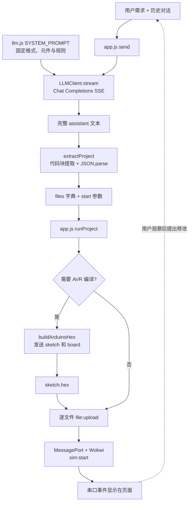
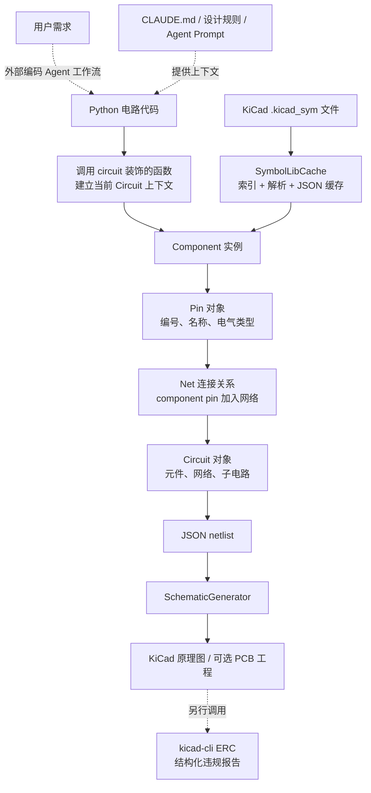
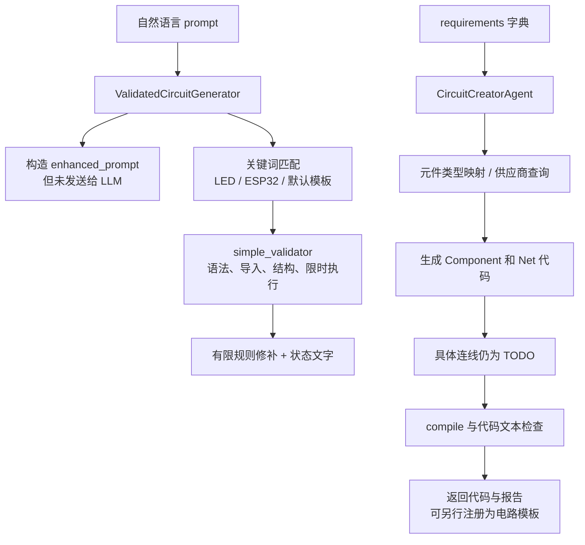

# 两个项目如何实现：程序框图、数据流与 Prompt

版本与证据范围见 [README](README.md)。本报告中的“源码可见”不是本地运行成功。

## 1. Circuit Lab：一次模型生成，宿主解析并启动仿真

### 1.1 实际程序框图



虚线是人工反馈。所读路径没有“日志自动回传模型→分析失败→重试”的 Core Loop，也没有请求中注册的 function tools。它是一个有对话历史的生成式应用，不能直接等同我们正在设计的工具调用 Agent。

### 1.2 主要文件如何分工

| 文件/入口 | 作用 | 关键数据 |
|---|---|---|
| [app.js](sources/circuit-lab/app.js)，`send()`，约804行 | 追加用户消息、接收模型流、保存回复、触发工程处理 | conversation、assistant 文本 |
| [llm.js](sources/circuit-lab/llm.js)，`SYSTEM_PROMPT` | 描述角色、输出文件集合、常见元件和规则 | 固定字符串，不是动态硬件数据库 |
| 同文件 `LLMClient.stream()` | 请求兼容 OpenAI 的 Chat Completions 接口，读取 SSE | baseUrl、apiKey、model、messages；temperature=0.4 |
| 同文件 `extractProject()` | 匹配 fenced code block，再 JSON.parse | `{files, start, explanation}` |
| [app.js](sources/circuit-lab/app.js)，`runProject()`，约622行 | 判断 AVR 编译、上传文件、启动模拟 | diagram、firmware、start |
| [build.js](sources/circuit-lab/build.js) | Uno/Mega/Nano/ATtiny85 编译桥接 | POST `{sketch, board}`，返回 hex/stdout/stderr |
| [wokwi-client.js](sources/circuit-lab/wokwi-client.js) | 把 API 命令包装成 Promise，按请求 ID 对应返回 | pending Map、命令响应、串口事件 |
| [message-port-transport.js](sources/circuit-lab/message-port-transport.js) | 与嵌入模拟器页面通信 | MessagePort 消息 |

### 1.3 关键输入和数据流

输入不是一份预先校验过的硬件规格，而是自然语言与对话历史。模型一次输出连接图、程序及启动参数。宿主接收的契约如下，省略号只是结构说明：

```json
{
  "explanation": "电路功能说明",
  "files": {
    "diagram.json": "{...元件实例和连接...}",
    "sketch.ino": "...Arduino C++ 源码..."
  },
  "start": {
    "firmware": "...固件文件名...",
    "elf": "...文件名..."
  }
}
```

注意 `files` 的值是文件内容字符串。`diagram.json` 内部才是 `parts` 与 `connections`。例如逻辑连接最终表达为 `['dht:SDA','esp:4',颜色,路径点]`。GPIO4 这里只是示意，不是我们的采购板接线定案。

它将两类决策一起交给模型：**接什么**以及**图上怎么摆**。宿主不会自行求解哪个 GPIO 合适，也不会从独立数据库验证连线的电压兼容性。

编译器桥接只发送 `sketch` 和 `board`，并不是完整的多文件、依赖锁定构建系统。模型能输出 `libraries.txt` 不代表这条编译路径就会安装其中所有库。

### 1.4 关键 Prompt：原文与实际效果

来自 [llm.js](sources/circuit-lab/llm.js)：

> You are a circuit-simulation copilot.

> YOU MUST RETURN EXACTLY ONE FENCED CODE BLOCK with language tag `wokwi-project` containing strict JSON of this shape:

> Always wire ground and power explicitly.

> Prefer the simplest board that fulfills the request.

Prompt 里还直接写 `wokwi-dht22` 的 `VCC, SDA, NC, GND`，以及 diagram 格式、串口连线、LED 电阻和布局范围。

可借鉴的是明确输出契约、限定目标平台、告诉模型必须满足的工程要求。问题是 **这些要求仍然只是提示词**。实际提取器核心判断只有：

```js
const obj = JSON.parse(raw);
if (obj && obj.files && typeof obj.files === 'object') return obj;
```

这不能保证 `diagram.json` 存在、每个值都是字符串、元件 ID 唯一、引脚有效或电路能运行。Prompt 写“strict JSON”也不等于调用了 JSON Schema 验证器。

### 1.5 确认的缺口

- Prompt 声称 ESP32/Pico Arduino 可在浏览器编译；`build.js` 明确说明未提供对应 builder。不能把这条路径当作 ESP32-S3 已完成方案。
- `runProject` 的 AVR 路径把 hex 文件名同时用于 firmware 和 elf；这不是规范 ELF 产物，不能照搬到 ESP32。
- 编译/启动错误与串口记录可供用户观察，但没有自动测试结论、重试预算或模型修正闭环。
- `sendCommand` 的 pending Promise 没有自己的超时；若对端不返回，可能持续等待。
- 浏览器 localStorage 的会话/工程版本保存，不是器件数据库，也不应当作机密存储方案。

**对我们的用途：**学习“需求→文件集合→宿主执行”的最小接口与工程预览。编译、硬件查询、测试和纠错仍应由明确的 tools 接管。

## 2. circuit-synth：电路库与 AI 包装层必须分开看

### 2.1 可靠的理解方式

它最值得借鉴的是 **用 Python 对象描述元件、针脚和网络，再生成 KiCad 文件**。外部编码 Agent 可以读取项目指导并写这些 Python 代码，但这不证明仓库内部每个 `agent.py` 都已经接通 LLM。



虚线不是库内已经验证的自动闭环。ERC 是可单独调用的检查入口，不应画成所有生成流程都会自动执行的步骤。生成 PCB 工程也不能直接推导为完成可制造的全部铜线布线。

### 2.2 真正的数据模型与缓存

顺序建议：

1. [core/decorators.py](sources/circuit-synth/src/circuit_synth/core/decorators.py)：`@circuit` 包装函数；调用时创建 Circuit，设置全局当前上下文，执行用户代码，最后恢复旧上下文。嵌套调用可以构建子电路。
2. [core/component.py](sources/circuit-synth/src/circuit_synth/core/component.py)：`Component` 根据 symbol ID 查符号信息，构建真实 Pin 对象。针脚可按编号/名称访问，同名的多个 GND 等可形成 PinGroup。
3. [kicad/kicad_symbol_cache.py](sources/circuit-synth/src/circuit_synth/kicad/kicad_symbol_cache.py)：实际主路径的 `SymbolLibCache`；解析 `LibraryName:SymbolName`，查 `.kicad_sym` 文件，按需读取，必要时建立全库索引。
4. [core/net.py](sources/circuit-synth/src/circuit_synth/core/net.py)：Net 自动注册到当前电路；`+=` 将针脚接入网络，也能合并网络。
5. [core/circuit.py](sources/circuit-synth/src/circuit_synth/core/circuit.py)：`generate_kicad_project()` 确定位号，导出 JSON 网表，再调用 `SchematicGenerator.generate_project()`。

缓存不是关系数据库：内存字典保存库数据；磁盘 JSON 保存解析结果；源文件 SHA-256 用于判断是否改变、是否需要重解析。这样可以复用第三方维护的符号库，而不把所有针脚硬编码进 Prompt。

需要纠正上一轮的路径：`core/symbol_cache.py` 确实存在，但 `Component` 导入的是 `..kicad.kicad_symbol_cache.SymbolLibCache`。研究实际调用链时应以后者为准。

### 2.3 连接关系的典型例子

下面是根据库接口写的教学示意，未执行。示例故意包含对函数的调用：只定义函数并不能证明电路对象已经构建。

```python
from circuit_synth import Component, Net, circuit

@circuit
def resistor_example():
    r = Component(symbol="Device:R", ref="R1", value="1k")
    supply = Net("VCC")
    ground = Net("GND")
    supply += r[1]
    ground += r[2]

design = resistor_example()
# 后续可以调用 design.generate_kicad_project(...)
```

`r[1]` 不是图上的像素坐标，而是符号库中某个针脚。`Net` 记录多个端点属于同一个电气节点。绘图/布局随后处理。我们可以借鉴这个关系模型，输出目标换成 Wokwi，不必引入整个 PCB 工作流，也不必把临时 Project IR 升为核心架构。

### 2.4 内部 Agent 路径：实际完成到哪里



两条路径是独立入口，不是串联的“多 Agent 系统”。

| 入口 | 真正输入 | 实际动作 | 不应声称 |
|---|---|---|---|
| [enhanced_circuit_agent.py](sources/circuit-synth/src/circuit_synth/ai_integration/claude/enhanced_circuit_agent.py) | prompt、circuit_type | 取设计上下文，构造增强 Prompt，关键词选固定代码，调用 validator | 不能说增强 Prompt 已发送给模型或具备 LLM 修正 |
| [circuit_creator_agent.py](sources/circuit-synth/src/circuit_synth/ai_integration/claude/agents/circuit_creator_agent.py) | name、description、category；可选 components | 参数检查、组件建议、模板代码、语法/文本检查 | 约372行仍有连接 TODO；不能说已经自动完成连线 |
| [simple_validator.py](sources/circuit-synth/src/circuit_synth/ai_integration/validation/simple_validator.py) | Python 代码、次数和超时 | AST/导入/结构检查、subprocess 执行、补部分 import 等规则修正 | 默认2轮、10秒，不是模型诊断修复；普通子进程也不是沙箱 |
| `circuit_registry.json` | 电路代码及元数据 | 注册/检索可复用电路模板 | 不是包含全部电气参数和模拟模型的硬件库 |

`circuit_design_agents.py` 和 `circuit_validation_agent.py` 还引用 `agent_registry`。所查固定提交树中未找到该模块；注册入口会捕获 ImportError。因此本轮不能把这些描述符当成开箱即用的 Agent 系统。这个判断限定于本次提交和审阅路径，不代表所有外部使用方式都不可用。

### 2.5 关键 Prompt 与提示词边界

[circuit_design_agents.py](sources/circuit-synth/src/circuit_synth/ai_integration/claude/agents/circuit_design_agents.py) 的原文节选：

> Before generating ANY circuit code, you MUST complete this research workflow:

> Load applicable design rules using get_design_rules_context()

> Search for appropriate KiCad symbols using /find-symbol

> Verify JLCPCB availability for all components

它把研究拆成“分析需求→查规则→查符号/供应链→制造检查→生成代码”，值得借鉴流程结构。但 `/find-symbol` 的文字不是本地已经注册并成功运行的 tool；Prompt 写的阶段秒数也不是程序强制超时。

[circuit_validation_agent.py](sources/circuit-synth/src/circuit_synth/ai_integration/claude/agents/circuit_validation_agent.py) 原文：

> Test generated circuit-synth Python projects by executing the code and capturing any errors. Provide detailed error analysis without making any design changes.

> Your role is VALIDATION ONLY. You detect and analyze errors but never modify code.

可借鉴“生成与判定分工”。但其中许多 Python 函数写在返回的 Prompt 字符串里，是对模型的说明，不是类上可直接运行的检查方法。

还应警惕提示词中的泛化工程规则，例如把所有 USB D+/D− 串联电阻固定成“Exactly 22ohm”。真实要求随芯片/PHY和参考设计变化。应把特定型号的规则与来源关联，由确定性工具检查，不能将整段 Prompt 当权威手册导入。

### 2.6 对 Hardware-CLAW 的具体借鉴

保留三个思路：

1. **元件查询返回针脚对象及来源**，而不是只返回“支持 DHT22”一段描述。
2. **连接关系先明确，再导出文件**，将逻辑针脚映射成 Wokwi 端点，布局单独处理。
3. **检查工具返回结构化错误**，Agent 根据错误决定修改；检查工具本身不改需求和验收标准。

不建议直接复用这两者的 Core Loop：Circuit Lab 没有自动工具反馈闭环；所查 circuit-synth 内部 Agent 实现不完整。我们继续以 LangChain 提供的循环为基础，优先补硬件检索、工程生成、lint、编译和场景仿真 tools。
