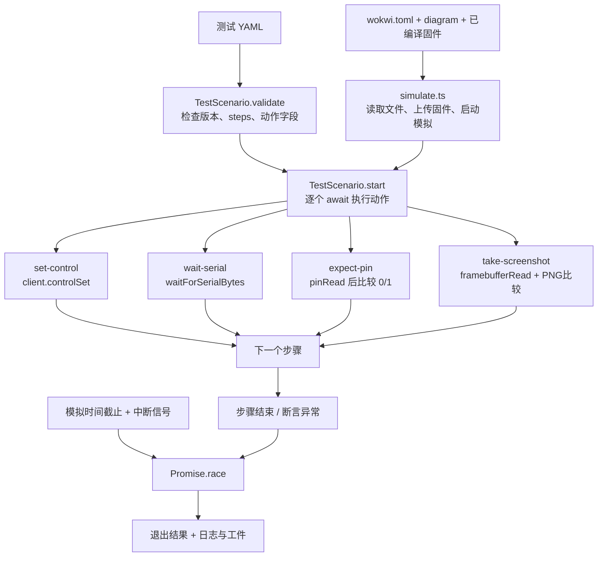

# 验证仿真：从上游源码提炼可实现的办法

## 1. 每一层回答不同的问题

| 检查层 | 方法 | 能确认什么 | 仍不能确认什么 |
|---|---|---|---|
| 文件与图结构 | JSON/schema、Wokwi DiagramLinter | 引脚名、部件引用、ID和属性等有效 | 电源设计、实际功能 |
| 接口与电气约束 | 自己的确定性规则；如有KiCad则用ERC补充 | 已编码的GPIO占用、电平、网络规则 | 未建模规则和现实全部电气行为 |
| 编译 | PlatformIO / ESP-IDF / Arduino CLI | 源码、库、构建设置可生成目标固件 | 接线和算法是否符合需求 |
| 场景行为 | Wokwi CLI + 独立YAML场景 | 给定输入下串口/引脚/显示输出符合断言 | 所有输入、性能及实物一致性 |
| 真机 | 上传、串口采集、实际传感器/执行器验证 | 本次硬件与环境下的真实行为 | 无条件的全场景可靠性 |

两个生成项目都没有提供我们可直接采用的完整验证闭环。最值得复用的执行机制在 **Wokwi CLI 和官方 part-tests**。

## 2. 官方 DHT22 示例：注入输入，再观察结果

[测试YAML](https://github.com/wokwi/wokwi-part-tests/blob/b224080de2c4fb54a420fd60a3daf1eb0fa2ab81/wokwi-dht22/dht22-esp32/dht22.test.yaml) 与 [固件](https://github.com/wokwi/wokwi-part-tests/blob/b224080de2c4fb54a420fd60a3daf1eb0fa2ab81/wokwi-dht22/dht22-esp32/src/main.cpp)。

真实做法：

1. 固件初始化 DHT，约每2秒读取，NaN时输出失败信息。
2. 测试先等待启动和传感器准备信息。
3. 连续检查23.50°C/45.80%的读数。
4. `set-control` 把模拟输入改成21.5°C/66.9%。
5. 等待相应新读数；若没有出现，最终应超时失败。

这比“串口打印了一句 PASS”更有验证价值，因为测试器主动改变外部输入，输出必须响应变化。但仍要防止固件硬编码测试序列，建议增加不同数值/隐藏测试，并检查GPIO或显示等独立输出。

原例是 ESP32 的 `esp32dev`，不是我们的 ESP32-S3。其启动ROM字符串不可照抄。原例使用 Adafruit DHT 库；当前 Wokwi DHT 文档却建议 ESP32 优先使用 `DHT sensor library for ESPx`。这说明示例和推荐路线不完全相同：我们应对选定板型、库版本做小规模实测，不能声称某一个组合已通过。

以下是我们未来可以采用的简化场景示意，未运行；对应固件需统一输出协议：

```yaml
name: DHT reading follows injected input
version: 1
steps:
  - wait-serial: 'APP_READY'
  - set-control:
      part-id: dht
      name: temperature
      value: 21.5
  - set-control:
      part-id: dht
      name: humidity
      value: 66.9
  - wait-serial: 'T=21.50,H=66.90'
```

`part-id` 必须匹配 diagram 中的实例 ID，不是型号名称。场景新写法用 `name`；CLI 0.22.1将原 `control` / `pin` 参数统一成 `name`，本轮所查源码仍兼容旧字段。官方文档标记场景API为alpha，需要固定版本。

## 3. CLI 内部具体如何执行

源码位置均已保存在 [sources/wokwi-cli](sources/wokwi-cli/)。



| 关键源码 | 核心实现 | 我们应保留的边界 |
|---|---|---|
| [TestScenario.ts](sources/wokwi-cli/packages/cli/src/TestScenario.ts) | 注册 handler；验证动作；顺序执行；fail抛异常 | 每一步只写一个动作；不能把 YAML 合法当功能通过 |
| [SetControlCommand.ts](sources/wokwi-cli/packages/cli/src/scenario/SetControlCommand.ts) | `client.controlSet(partId, controlName, value)` | 控制项须为模型支持的运行时输入 |
| [WaitSerialCommand.ts](sources/wokwi-cli/packages/cli/src/scenario/WaitSerialCommand.ts) | 文本编码成字节，`waitForSerialBytes` | 这是字符串/字节匹配，不是带容差的数值判定器 |
| [ExpectPinCommand.ts](sources/wokwi-cli/packages/cli/src/scenario/ExpectPinCommand.ts) | `pinRead`返回值转成0/1，再与expected比较 | 适合数字电平；不能冒充模拟电压/PWM频率测量 |
| [TakeScreenshotCommand.ts](sources/wokwi-cli/packages/cli/src/scenario/TakeScreenshotCommand.ts) | 读framebuffer，PNG解码，检查宽高，逐字节比较像素 | 是严格相等，不是OCR或视觉模型理解；需可信基准图 |
| [commands/simulate.ts](sources/wokwi-cli/packages/cli/src/commands/simulate.ts) | 注册场景、采集串口、模拟时间截止、Promise.race和中断处理 | 启动/网络阶段还要宿主墙钟超时兜底 |

`wait-serial` 等不到字符串时不应被解释成“模型还在思考”，它是在等待客观事件。调用者必须有截止条件。

## 4. 屏幕验证：测试真正显示的内容

[官方 SSD1306 场景](https://github.com/wokwi/wokwi-part-tests/blob/b224080de2c4fb54a420fd60a3daf1eb0fa2ab81/board-ssd1306/oled-esp32/ssd1306.test.yaml) 在计数器输出0、1、2后，读取 OLED framebuffer 并分别对比基准图片。

对我们的启发是：**串口温湿度正确与屏幕显示正确要分开断言**。程序可能串口正确但屏幕没接、坐标超出边界或只刷新了一部分。

第一阶段可保持旧SSD1306示例作测试机制教学；ST7789另建兼容性试验。240×240模拟模型与240×320实物差异尚未解决，不能把旧OLED通过作为采购屏通过。

严格截图适合字体、布局、分辨率和时刻都稳定的界面。基准图应经过独立审阅，不能把本轮生成工程的首次截图自动当成正确答案。若出现动态时间/闪烁等变化，可后续实现固定区域或语义检查；这不是当前CLI截图命令已有能力。

## 5. 超时：模拟时间与墙钟时间必须分开

当前 `simulate.ts` 默认 `--timeout 30000`，默认超时退出码42。实现使用 `client.atNanos(timeout * millis)`，因此主要限制的是 **模拟时间**。网络连接或服务无响应时，模拟时间可能不推进。

建议我们的 `run_simulation` tool 至少管理：

- Wokwi模拟时间上限，例如30秒，超时为非零退出码。
- 宿主进程墙钟上限，例如90秒（示例值，实测再调整），到期终止整个子进程树并收集日志。
- 每次运行独立目录、工件哈希、CLI/编译工具版本与场景版本。
- 整个修正循环的最大轮数、总墙钟时间和token预算。
- 对相同工件重复产生相同错误设置无进展退出条件；停止后输出可诊断报告。

不能设置 `--timeout-exit-code 0` 后单凭exit code宣布通过；也不能把所有非零退出都归为电路设计错误。服务鉴权、网络、缺少文件和真实断言失败需要区分。

## 6. 建议 tool 契约与闭环

下面是建议接口，不是已经写入当前 LangChain 的实现：

| Tool | 输入 | 确定性工作 | 输出 |
|---|---|---|---|
| `get_component_info` | 器件ID/型号 | 返回硬件事实、来源、未知字段与模型映射 | 有依据的字段，不造缺失参数 |
| `validate_wiring` | 元件实例、连接、板卡配置 | 引脚存在、GPIO占用、已知电平/供电约束 | 错误代码、端点、依据 |
| `lint_wokwi_project` | 受控工程路径 | JSON检查 + 官方DiagramLinter | valid、issues、工具版本 |
| `compile_project` | 工程ID、固定构建配置 | 启动受控编译器、收集诊断 | 固件路径/哈希、退出状态、耗时 |
| `run_simulation` | 工程ID、受信测试ID、限时 | 加载既定场景、运行CLI、保留证据 | pass/fail/timeout/tool_error/unsupported |

测试允许由模型起草，但进入验收前应冻结、审阅并与生成工件隔离；生成Agent不能自行改成更宽松的通过条件。工具接收受信test ID而不是任意可改的验收文本。

返回格式示意：

```json
{
  "status": "fail",
  "stage": "simulation",
  "project_revision": "artifact-hash",
  "test_suite_revision": "test-hash",
  "failed_checks": [
    {"id": "sensor_response", "expected": "new reading", "observed": "old reading"}
  ],
  "exit_code": 1,
  "wall_time_ms": 8000,
  "simulation_time_ms": 6000,
  "artifacts": {"serial_log": "controlled-output/serial.log"}
}
```

这些示例数值不是本次测量。模型token由Core Loop记录，不应伪装成Wokwi提供的指标。`unsupported` 表示当前模型/工具不能覆盖某项验证，不等于通过，也不一定需要修改电路。

Core Loop依据结果工作：成功则交付；设计/代码失败则修正并重测；工具故障只做有限重试；不支持或预算耗尽则停止并报告。harness同时约束工具输入、路径、进程、时间和循环次数。

## 7. 如何确认测试本身有用

优先做少量有明确目的的错误注入：

| 人为引入的错误 | 预期发现层 |
|---|---|
| diagram中的不存在针脚 | lint |
| diagram与固件GPIO分配不一致 | 连线一致性检查；必要时行为测试 |
| 把传感器读取改为常数 | 修改输入后的场景断言 |
| 只输出旧读数、不刷新屏幕 | 新输入+截图比较 |
| 人为死循环或等待永不出现的串口文字 | 超时与循环退出机制 |

这比只证明一个正确例子能通过更能评价验证能力。后续可报告：基准通过率、注入错误检出率、修复成功率、平均修复轮数、token消耗、墙钟时间和仿真时间。

不同LLM可用于交叉审阅需求、代码或测试设计，但模型一致同意不能代替编译器、可执行断言和真机证据。板间通信验证以后可复用“独立输入→另一端观测→时限断言”的原则；是否能在当前Wokwi后端模拟所选多板拓扑，需要另行确认。

## 8. 推荐的第一项实验

先不让Agent生成整个系统。使用已有DHT22示例，完成一组“正常读数能通过、改错GPIO或改为常数会失败、超时能退出”的验证实验。随后再把同一测试执行器封装为tool，让Agent使用结构化报告修复。

这样先确认裁判可靠，再评价生成能力；本轮只形成研究与方案，没有执行这一实验。
